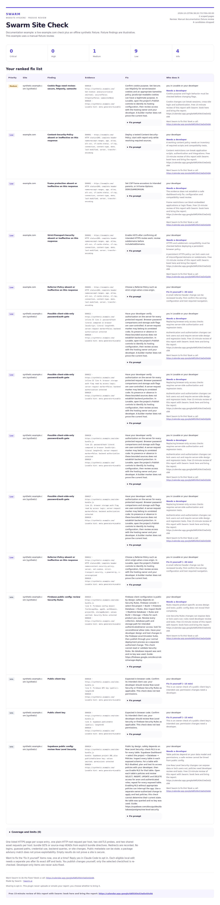

# Swarm Site Check

A free, open-source Claude Code plugin for website owners. Run `/site-check` to get a ranked fix list from a passive check and an independent second opinion. The report explains the evidence, the fix, and who can do it.

Made by Swarm ([5warm.ai](https://5warm.ai)). MIT licensed.

## Install

Run these two lines inside Claude Code:

```text
/plugin marketplace add 5WARM-AI/swarm-site-check
/plugin install site-check@swarm-site-check
```

Then type `/site-check`. If another command owns that short name, use `/site-check:site-check`. Restart Claude Code if the new plugin is not visible. The repository must be published at the GitHub path above before remote installation is available.

The checker uses Python 3.9+ and its standard library on macOS, Linux and WSL. No pip, Node, browser, scanner, API key, or package installation is needed. If `python3` is missing, the launcher stops with a clear message before any requests. Claude Code itself requires your usual Claude access; Swarm charges nothing for this plugin.

## Run it

1. Provide domains or a text file with one domain or explicit page URL per line.
2. Review the complete normalized list and confirm **“these are sites I own or run”**. Without that confirmation, collection stops.
3. The script collects redacted evidence and checks detected package versions against OSV.
4. A fresh Claude subagent checks every candidate against the raw evidence, dropping or downgrading unsupported findings.
5. Open the local `report.html`; the chat includes a Markdown summary. Each report row has severity, site, finding, evidence, fix, owner, and an honest effort tag with a one-line reason: **Fix it yourself (~N min)** or **Needs a developer**. Unknown code/policy work gets no time estimate. Severity is independent of effort and booking links. Developer rows end with the optional booking line.

Optional discovery can list projects through an already-installed, already-authenticated `wrangler` or `vercel` CLI after you request it. Only fixed read-only list commands are permitted. Supply custom domains or zone exports yourself when project output lacks them. Discovery never counts as ownership confirmation.



[Open the self-contained example](docs/example-report.html). Its label distinguishes the live example.com observations from the synthetic fixture and manual documentation review. No private hosts or private test evidence are included.

## What it checks

| Area | Public evidence |
|---|---|
| Browser headers | HSTS, CSP, X-Frame-Options or CSP frame-ancestors, nosniff, Referrer-Policy |
| Cookies | Secure, HttpOnly and SameSite flags; cookie values are discarded |
| HTTP and TLS | HTTP-to-HTTPS redirect, certificate issuer/expiry/chain verification, expiry under 21 days, TLS 1.0/1.1 acceptance |
| Public software | Server/X-Powered-By, recognized meta generators, WordPress core/plugin/theme asset versions, decoded n8n sentry release, Next.js/Vite/React markers and explicit versions |
| Potential secrets | JWT role classification, Stripe/OpenAI/Anthropic/AWS/Google/GitHub/Slack keys, Supabase secret versus public keys, private-key blocks, truncated n8n webhook references, client-side password hashes |
| Public app configuration | Supabase project URL plus anon/publishable key prompts a **Row Level Security** review for every table; Firebase config prompts a **Security Rules** review. Exact dashboard steps are included; policy state remains untested |
| Browser gates | Password/hash comparisons and sessionStorage/localStorage auth flags in inline JavaScript and fetched bundles; possible client-side-only gating, with backend uncertainty stated |
| Source maps | Only a fetched bundle's own final `sourceMappingURL`, same origin, HEAD only; no contents downloaded, no guessed paths |
| Preview visibility and platforms | Included preview/review/staging or public project pages with HTTP 200 and no observed login/noindex; Lovable, Bolt, Replit, Vercel, Netlify and Cloudflare Pages hints direct fix advice |
| Mail and DNS | Apex SPF/DMARC using the bundled Public Suffix List; unresolved CNAMEs to recognized provider suffixes, reported as “check” |
| Public interfaces | Access-review hints for explicitly listed admin/demo-looking pages; linked admin URLs are recorded for separately confirmed checks |
| Advisories | Live OSV queries for mapped packages, advisory IDs, supplied severity and fixed release lines |

The ordinary per-host budget is one HTTPS page, one plain-HTTP root GET, two legacy TLS probes, **two shared asset requests** (same-origin JS bundle GETs or source-map HEADs), A/AAAA DNS, and cached apex TXT lookups. A map HEAD consumes one of the two asset slots. The collector inspects a map immediately after its referring bundle when budget remains; skipped maps/bundles are marked in coverage. Each extra explicitly listed path adds one page GET. The HTTPS page supplies the certificate handshake; HTTPS assets and API calls also use ordinary TLS handshakes. Requests are sequential, spaced at least 150 ms apart for each site request/probe, limited to 8-second socket deadlines and 2 MiB per page/bundle. Service responses have an 8 MiB cap. No automatic retry or redirect is performed.

## What it never does

- Commit, push, publish a deployment, change DNS/account/cloud settings, or apply a local edit without approval of that item's exact diff.
- Log in, send authentication/cookies, test credentials, invoke a webhook, exploit a vulnerability, fuzz, guess paths, enumerate directories, scan ports, or run security scanners.
- Fetch cross-origin scripts, source-map contents, extra chunks, redirect destinations, or linked admin pages automatically. Only explicit same-origin map directives qualify for HEAD.
- Query Supabase tables or Firebase databases/storage, use found keys, upload reports, or email reports.
- Print or persist page/bundle bodies, cookie values, secret values, private keys or full webhook tokens. Raw evidence contains redacted facts only.
- Claim a dangling provider resource or treat an unavailable check as proof of safety.

## Guided fixes after the report

Claude ends by offering **“Want to fix the 'Fix it yourself' items now, one at a time?”** Only your yes starts guided fix. Claude locates the active configuration in your open project, prepares one exact diff, explains how to test it, and waits for a new yes before applying that item locally.

The local recipes add Referrer-Policy or X-Content-Type-Options: nosniff to an existing `_headers`, simple `next.config.js/mjs/ts`, `vercel.json`, `netlify.toml` or `.htaccess`. Nosniff remains **Needs a developer** until you explicitly confirm that assets are served with correct MIME types; only then can its local recipe be offered. Both recipes require confirmation of the serving file and absence of authentication/access dependencies. An existing `/*` block in `_headers` receives the new header. Complex configurations, existing target headers and uncertain access impact go to a developer. Public client-key items offer read-only verification of intended use.

For settings, Claude gives exact owner-operated dashboard steps or exact provider-approved DNS values. A platform header is only a hint; you confirm the actual provider first. The plugin never signs in, writes a cloud API or runs a settings-changing CLI. SPF/DMARC values require your mail-provider/sender inventory and a developer-approved policy; it never guesses a record.

You publish through your existing project workflow. After you confirm the change is live, Claude re-checks **only that finding on that confirmed host**, showing before/after evidence. If it is still local, it says **“deploy, then re-check”** and supplies the one command. Plan and re-check output must stay outside the open project; the scripts enforce this before writing artifacts or sending re-check requests. The next item waits until this item is finished or deferred.

Live Supabase RLS / Firebase rules, authentication, server/runtime/package upgrades, key rotation and any possible lockout stay **Needs a developer**, with a reason and the optional free 15-minute review link. Every code finding includes a copyable **Fix prompt** with File, Change and How to test, also saved in `fix-prompts.md`. Public evidence cannot identify an exact local file; that file is located and confirmed before an edit. See [guided-fix details and commands](docs/guided-fixes.md).

## Privacy and limits

Collection and report generation run locally. Nothing is sent to Swarm. Confirmed websites receive normal visitor requests with `SwarmSiteCheck/1.0 (+https://5warm.ai/guides/site-check/)`. Cloudflare's public DNS-over-HTTPS service receives DNS names. OSV receives package names, ecosystems and versions; it receives no site URLs, cookies or page contents. If you request project discovery, the selected cloud provider receives its normal read-only CLI request.

The Claude command and reviewer read the **redacted** evidence in your existing Claude Code session, so that evidence is processed under your Claude account/provider settings. Reports remain local; opening the HTML loads no external assets. Footer links make requests only when you click them. The plugin has no telemetry. The final invitation is opt-in: **Free 15-minute review of this report with Swarm: book here and bring the report** ([booking link](https://calendar.app.google/6AfUX9o53wDxtQs9A)). Nothing is uploaded or emailed; you choose whether to share the report.

Important coverage limits:

- Public version strings and `ver=` parameters can be stale or refer to bundled dependencies. Framework markers alone never establish a version. Public headers do not establish a hidden runtime's patch level.
- npm packages and identifiable Packagist packages are mapped explicitly. WordPress core/plugins/themes use the documented OSV ecosystem names, but database coverage is not assured. The report also points to [WPScan](https://wpscan.com/) and [Wordfence Intelligence](https://www.wordfence.com/threat-intel/vulnerabilities/). Server/runtime builds without a reliable package identity are marked unmapped with vendor-advisory guidance. No hard-coded CVE list is shipped.
- OSV results can be incomplete or unavailable. Up to four querybatch pages and 100 unique advisory detail records are retrieved per run. Remaining IDs retain an unrated severity. Vector-only CVSS ratings are left unrated when OSV supplies no categorical/numeric rating. Fixed versions describe release branches; the owner must choose an appropriate supported branch.
- Public login shells, client-side gates and potential key patterns do not prove access to protected data. Supabase publishable/anon keys and Firebase client config are public by design; Row Level Security and Security Rules are not tested. Config recognition uses bounded literal patterns; computed/minified/obfuscated configuration or gates can be missed. Absence of a server-request marker in fetched code cannot prove absence of backend checks.
- A source-map HEAD 200 establishes only an answering URL. Maps with inline data, other origins, query parameters, fragments, ambiguous directives or incomplete referring bundles are skipped. No map contents are read. Platform hints can identify a builder or CDN without identifying the origin host. Preview checks use observed status/login/robots markers and do not execute a browser login flow. Noindex is not access control.
- Certificate trust uses your local CA store. Chain enumeration uses available Python SSL APIs and states when unavailable. TLS 1.0/1.1 probes can be blocked by local OpenSSL; inconclusive probes say **“not tested on this machine”**. No insecure certificate fallback is used for page requests.
- DNS checks cover the named hosts and recognized provider suffixes only. Cloudflare Tunnel targets are excluded from takeover heuristics. Unknown DNS responses are not treated as missing records. The bundled suffix list can age; updates belong in plugin releases.
- No browser JavaScript execution occurs. Checks see only the listed response and up to two eligible bundles within the shared asset budget. Compressed responses that ignore `Accept-Encoding: identity` and oversized bodies are marked incomplete. Private/local IPs and non-default ports are refused.
- The renderer checks review completeness, citations, digest and allowed severity changes. It cannot prove which person or model authored a review file. The command prompt mandates the fresh reviewer and stops if it is unavailable.
- Guided plans are bound to the accepted finding, evidence/review hashes, project and exact file contents. The helper refuses symlinks, hard links, suspicious credentials and unsupported configurations. Consent flags record the conversation's approval; they cannot independently prove who supplied it. A successful header re-check describes one response; it does not validate every route, browser behavior or backend permission.

## Development and verification

```sh
python3 -m unittest
sh scripts/selftest.sh --offline
sh scripts/selftest.sh
claude plugin validate . --strict
claude plugin validate .claude-plugin/plugin.json --strict
claude plugin validate skills --strict
claude plugin validate agents --strict
```

`selftest.sh --offline` runs synthetic parser, mocked transport, consent and report tests with no network or prompt. Without that flag, `selftest.sh` then displays the fixed example.com scope and waits for `check example.com` before making requests. It writes redacted evidence under `.work/`. The synthetic fixtures contain deliberately fake values only. The full Claude command dry run additionally exercises ownership confirmation, the fresh reviewer, and report generation on your machine.

For local plugin testing, start `claude --plugin-dir .` from this repository. See [format verification](docs/format-verification.md) for the official documentation checked when packaging this release. The checker is deterministic for the same responses; live sites, certificates, DNS and OSV naturally change over time.

Want Swarm to do the fixes? [Book a call](https://calendar.app.google/6AfUX9o53wDxtQs9A).

Made by Swarm · [5warm.ai](https://5warm.ai)
